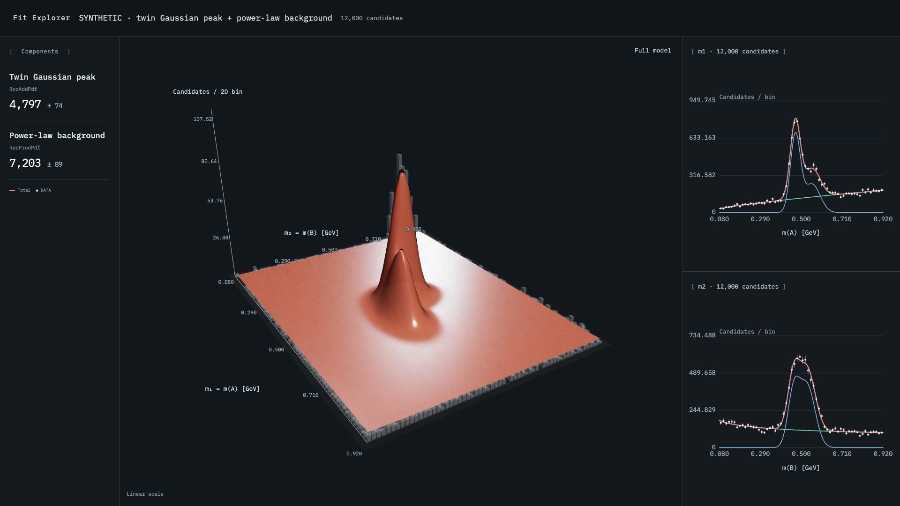
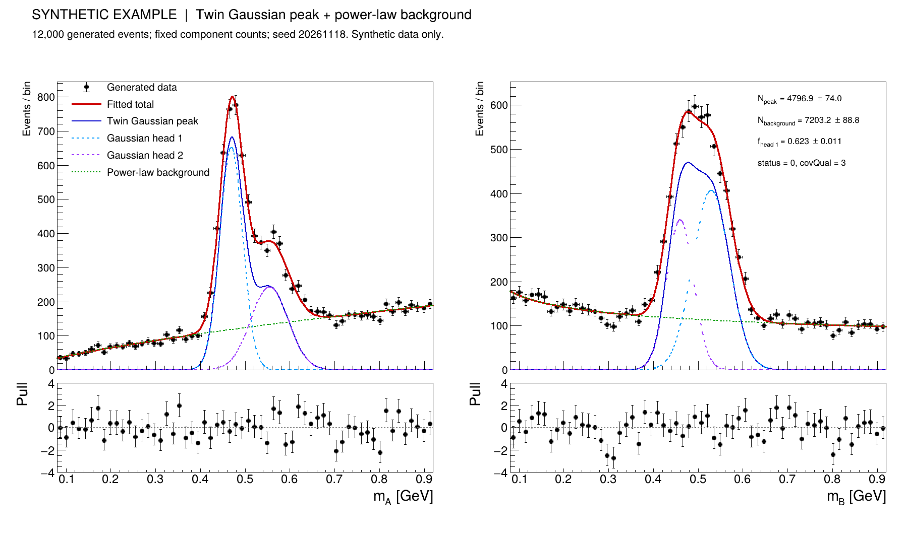

# Fit Explorer

An offline 3D viewer for two-dimensional RooFit results, with component
decomposition, smooth projections, draggable mass windows and five-second
animations. One ROOT file contains the fitted model, data, covariance and native
display tables.



## Try it

The offline distribution contains **FitExplorer.html**. Open it in a modern
browser: the fitted synthetic example is already loaded. No installation,
server, Python or ROOT is required for viewing.

Drop a compatible `.root` file anywhere in the viewer to open it, or use
**Load FIT**. **Data guide** explains
saving from RooFit, with **Copy instructions**, **Copy code** and **Download
example ROOT**. Files are processed locally; the viewer does not upload them,
execute native PDF code or require a runtime CDN.

## Build from source

Requirements: **Node.js 22.22.2+, 24.15+ or 26+** and npm.

From the repository root:

```bash
npm ci --ignore-scripts
npm run build
npm start
```

Open the local address printed by the server. It binds to loopback and does not
open a browser automatically. You can also open `dist/fit-explorer.html` directly
for fully offline use. `npm run dev` builds and starts the viewer in one command.

## Save your RooFit result

Viewing needs no ROOT installation. Saving a new fit requires Python with
[PyROOT](https://root.cern/install/) available. Install the Python helper into
that environment:

```bash
python -m pip install .
```

Then call it after your existing fit:

```python
from fit_explorer import save_fit_root

save_fit_root(
    "fit.root",
    model=model, data=data, result=result,
    axes=[(mass_a, "m(A)", "GeV"), (mass_b, "m(B)", "GeV")],
)
```

`result` is the RooFitResult returned by `fitTo(..., Save=True)`. The saver
checks the fitted parameter state, preserves the native covariance and prepares
bin integrals and smooth projection tables. It does not rerun the fit.

Extended `RooAddPdf` and `RooExtendPdf` models provide automatic component
discovery. Nested additive mixtures become expandable children with yield errors
propagated through the full covariance. Product PDFs remain whole shapes.
Names, order and hierarchy are stored in the ROOT file rather than assumed by
the viewer. Advanced models can supply an explicit component/yield mapping.

See [installation](docs/INSTALL.md), [Python API](docs/PYTHON_API.md) and the
[ROOT format](docs/ROOT_FORMAT.md) for normalization, weights and supported cases.

## Included example

`examples/twin-gaussian.root` is entirely synthetic: 12,000 fixed-count events,
seed 20261118, a two-head Gaussian peak near 0.5 and a power-law background.
The saved extended fit has status 0 / covariance quality 3 and includes the two
Gaussian children, their correlated yield errors and generation truth.

| Component | Generated | Fitted yield |
| --- | ---: | ---: |
| Twin Gaussian peak | 4800 | 4796.9 ± 74.0 |
| Gaussian head 1 | 2976 | 2990.8 ± 68.9 |
| Gaussian head 2 | 1824 | 1806.2 ± 61.1 |
| Power-law background | 7200 | 7203.2 ± 88.8 |

The head rows partition the peak; they are not additional events.



Reproduce it using a PyROOT environment and a new output directory:

```bash
python -m fit_explorer.demo --output demo-run
```

The ROOT file is self-contained. No experimental data, external datasets or
previous fit results are needed.

## Controls

- Toggle linear/log counts and adjust the 3D log minimum.
- Orbit, zoom or choose a camera preset. Mass axes follow the camera-facing edges;
  text is clipped by the model at the glyph level.
- Select components or inspect nested mixtures and their parameters.
- Resize either dashed projection boundary; drag inside to move the window.
  Both projections use the same selected events and retain the other mass window.
- Play the five-second component animation. Counts are summed before display
  transforms; the model is never rescaled to the observed total.

## Optional MP4 and GIF export

Install FFmpeg and Playwright Chromium, then:

```bash
npx playwright install chromium
npm run render -- --output animation
```

The same five-second scene is exported as a 1920×1080, 30 fps MP4 and a
1280-pixel-wide, 15 fps looping GIF. To orbit selected components at their full
saved yields with a readable label:

```bash
npm run render -- --output peak-animation --components twin_peak --label "Twin Gaussian peak"
```

Use comma-separated IDs for a group; their counts are summed on the original
full-model height scale. See [installation](docs/INSTALL.md) for browser and
output options.

## Tests and development

```bash
npm test
npx playwright install chromium
npm run test:browser
```

Native saver tests require PyROOT:

```bash
python -m unittest discover -s tests -p test_io.py -v
```

GitHub Actions builds and checks the browser package. Native saver checks can be
run in any supported local PyROOT environment. See [CONTRIBUTING.md](CONTRIBUTING.md).

## License

Fit Explorer source code is licensed under [MIT](LICENSE). Bundled dependencies
retain their own licenses and author notices; see [THIRD_PARTY_NOTICES.md](THIRD_PARTY_NOTICES.md)
and [LICENSES](LICENSES/).
